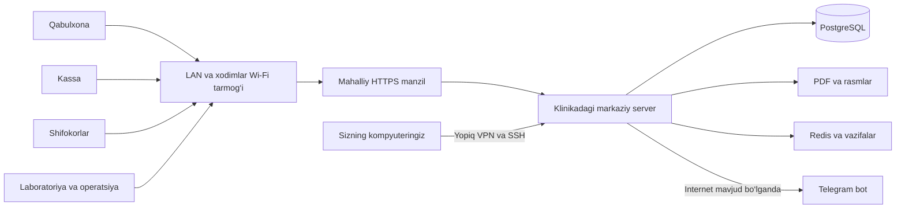

# Sevinch Medical Center mahalliy o‘rnatish va yangilash tahlili

2026-yil 16-oktabr. Ushbu tahlil hozirgi ishchi nusxa, sozlamalar, ishga tushirish skriptlari, ma’lumotlarni saqlash va yangilash jarayoniga tegishli.

Loyiha klinika ichidagi bitta markaziy serverda ishlashga mos. Qabulxona, kassa, shifokor, laboratoriya va operatsiya xonasi kompyuterlari brauzer orqali shu serverga ulanadi. Yangi funksiya qo‘shilganda markaziy server yangilanadi; har bir ish joyida dasturni qayta o‘rnatish kerak emas. Oldindan sozlangan VPN orqali yangilashni masofadan bajarish mumkin.

**Hozirgi nusxani o‘zgarishsiz klinikaga ko‘chirish tavsiya etilmaydi.** Klinik jarayonlar mavjud, ammo mahalliy ishlab chiqarish muhiti uchun HTTPS, manzillar, avtomatik ishga tushish, xavfsiz release, muntazam zaxira va ayrim xavfsizlik tuzatishlari kerak. Quyidagi sxema va sozlamalar — tayyorlash rejasi; klinika serveriga hali o‘rnatilmagan.

## Klinikadagi ishlash sxemasi



Server kabel bilan switch/routerga ulanadi. Router unga o‘zgarmaydigan IP ajratadi. Masalan, `192.168.10.10` va `https://sevinch.internal` ishlatilishi mumkin; bular namunaviy manzillar, haqiqiy tarmoq diapazoni tekshirilgach tanlanadi. Mahalliy DNS barcha ish joylarida shu nomni serverga yo‘naltiradi.

Bir xil Wi-Fi nomi qurilmalar o‘zaro ko‘rishishini kafolatlamaydi. Guest tarmoq, client isolation va VLAN qoidalari tekshiriladi. Xodimlar serverga kira oladi; bemorlar uchun mehmon Wi-Fi alohida ajratiladi. Server, router, switch va kerakli Wi-Fi qurilmalari UPS bilan himoyalanadi.

Kompyuterlarga Node.js, PostgreSQL yoki loyiha kodi o‘rnatilmaydi. Zamonaviy brauzer, server manziliga yorliq va tegishli printer yetarli. Windows ishchi kompyuterlar Linux server bilan ishlay oladi.

## Qaysi holatda ish davom etadi

| Holat | Natija |
|---|---|
| Internet uzildi, server va LAN ishlayapti | Mahalliy bemor kartalari, qabul, kassa yozuvlari, laboratoriya, statsionar va mahalliy chop etish ishlashi mumkin. Joyida internetni uzib qabul sinovi o‘tkaziladi. |
| Telegram yoki internet ishlamayapti | Botdan hujjat olish va Telegram kirish kodi vaqtincha ishlamaydi. Telegramga bog‘liq kirish/2FA uchun oldindan kelishilgan vakolatli uzluksizlik tartibi kerak. |
| Bitta kompyuter Wi-Fi’dan uzildi | O‘sha kompyuter serverga saqlay olmaydi. Qolgan ulangan ish joylari davom etadi. |
| Server o‘chdi yoki butun ichki tarmoq uzildi | Asosiy tizimdan foydalanish to‘xtaydi. Brauzerda keyin sinxronlanadigan mustaqil offline yozish mexanizmi mavjud emas. |
| Internet bor, siz boshqa joydasiz | Server va VPN ishlasa, masofadan texnik xizmat va yangilash mumkin. |

Naqd, karta va Click — hozir kassir qayd qiladigan to‘lov usullari. Dasturda to‘lovni qayd qilish bilan bank terminali yoki Click xizmatining haqiqiy tasdig‘i bir xil jarayon emas. Internet uzilganda tashqi to‘lov xizmatining mavjudligi alohida tekshiriladi.

Bot serverdan Telegramga tashqariga ulanish orqali ishlaydi. Bemor uyidan ham hujjat olishi uchun klinika serverining web portini internetga ochish talab qilinmaydi. Server yoqilgan va internetga ulangan bo‘lishi kerak. Bot orqali yuborilgan hujjat Telegramga uzatiladi; ma’lumotlarning asosiy bazasi mahalliy saqlanishi bu nusxaning tashqi xizmatga yuborilishini bekor qilmaydi. Kod: `apps/api/src/modules/notifications/telegram-bot.service.ts:140`, `:697`.

## O‘rnatishdan oldin hal qilinadigan masalalar

| Ustuvorlik | Hozirgi dalil | Amaliy yechim |
|---|---|---|
| Ishga tushirishdan oldin | `.env` mahalliy laptopga mos: API `localhost:3101`, CORS faqat localhost, `NODE_ENV=development`, demo tugmalar yoqilgan. Frontendlarning `.env.local` fayllari ham localhost manzillarini saqlaydi. | Klinikaga alohida production sozlamalar. Laptop sozlamalarini ko‘chirmaslik; demo hisoblarni o‘chirish/almashtirish va demo tugmalarni build vaqtida yashirish. |
| Ishga tushirishdan oldin | `scripts/start-clinic.mjs:12` bo‘sh `NEXT_PUBLIC_API_URL`ni `API_URL` bilan almashtiradi. `:13` WebSocket uchun ham shunday. | Bo‘sh qiymat same-origin ma’nosini saqlaydigan qilib helperni tuzatish yoki klinikaga alohida build konfiguratsiyasi. Aks holda boshqa kompyuter API’ni o‘z localhostidan qidiradi. |
| Ishga tushirishdan oldin | To‘lov/chek/operatsiya formalarida `crypto.randomUUID()` ishlatiladi: `receipt-printer.tsx:39`, `patient-pay-dialog.tsx:178`, `staff-fees-card.tsx:65`. | Oddiy HTTP-IP o‘rniga barcha ish joylari ishonadigan HTTPS. Bu brauzer funksiyasi secure context talab qiladi. [MDN](https://developer.mozilla.org/en-US/docs/Web/API/Crypto/randomUUID). |
| Ishga tushirishdan oldin | `scripts/deploy.sh:10` boshqa tashqi serverni default oladi; `:29` active katalogga `rsync --delete`, `:49` ishlayotgan buildlarni o‘chirish. | Eski skriptni klinikaga ishlatmaslik. Target aniq ko‘rsatiladigan, alohida release va tekshirilgan qaytish yo‘li bor jarayon tayyorlash. |
| Ishga tushirishdan oldin | `pnpm audit --prod` 688 dependency bo‘yicha 53 ogohlantirish qaytardi: 3 critical, 28 high, 21 moderate, 1 low. | Tegishli kutubxonalarni yangilash, shartli ta’sirini tekshirish, regressiya sinovlari va takroriy audit. Bu hisob ekspluatatsiya qilingan 53 ta amaliy xato borligini bildirmaydi. |
| Ishga tushirishdan oldin | `docker-compose.yml:7` development DB credentiallari, `:10` DB porti va `:25` Redis porti barcha interfeyslarga chiqadi. | PostgreSQL/Redis faqat server ichida yoki yopiq container networkda. Alohida kuchli credentiallar. Xodimlar faqat HTTPS orqali kiradi. |
| Ishga tushirishdan oldin | `start-clinic.mjs:95` bir jarayon tugasa qolganlarini ham to‘xtatadi. Bu supervisor emas. | Har asosiy xizmatga avtomatik restart va kompyuter yoqilganda start. Elektrdan keyingi tiklanishni amalda sinash. |
| Ishga tushirishdan oldin | Repositoryda ishlaydigan to‘liq backup/tiklash avtomatizatsiyasi yo‘q. README’da misol bor; oldingi ishda bir martalik DB zaxirasi olingan. | Muntazam DB va fayl backupi, alohida diskdagi nusxa, xato xabari, tiklash sinovi. |
| Ishga tushirishdan oldin | `storage.module.ts:6` doim local provider ishlatadi, `STORAGE_DRIVER=s3` tanlovi provider almashtirmaydi. | Yuklangan PDF/rasmlarni release papkasidan tashqarida doimiy saqlash; DB bilan birga zaxiralash. |
| Xavfsizlik tuzatishi | `principal.service.ts:48` JWT’dan foydalanuvchini tekshiradi, ammo bekor qilingan AuthSession holatini tekshirmaydi. | Sessiya egasi, muddati va bekor qilinganini API/WS ruxsat tekshiruvida hisobga olish. Hozir eski access token logout/parol o‘zgargach ham o‘z muddati tugaguncha ishlashi mumkin; default 15 daqiqa. |
| Nazorat tuzatishi | `health.controller.ts:15` nosozlikda ham HTTP 200 bilan `degraded` qaytaradi; deploy bo‘sh bo‘lmagan javobni muvaffaqiyat deb oladi. | Readiness timeout va 503, DB/Redis holatini tekshirish; hozircha HTTP bilan birga JSON ichidagi holatni ham tekshirish. |
| Ma’lumot maxfiyligi | `app.module.ts:65` loglarda to‘liq URL saqlaydi; qidiruv querysida ism/telefon bo‘lishi mumkin. | Query ma’lumotlarini yashirish, log hajmi va saqlash muddatini cheklash, kirishni vakolatli xodimlargagina berish. |

`deploy.ecosystem.example.js` va `docs/DEPLOY.md` boshqa serverga oid eski misollardir. U yerdagi domen, IP, katalog va “yoqilgan” deb yozilgan holatlar klinikadagi o‘rnatish bajarilganiga dalil emas.

### Kutubxonalar auditi bo‘yicha aniqlik

Tekshiruv lockfile’dagi versiyalarni ma’lum advisorylar bilan solishtirdi. Ishlayotgan ilovaga hujum yoki bemor ma’lumotlariga kirish sinovi bajarilmadi. To‘liq sonlar va paket yo‘llari `LOCAL_DEPENDENCY_AUDIT_2026-10-16.json` faylida saqlangan.

Next.js `15.5.20` uchun Windows serveriga bog‘liq critical advisory va AVIF optimizatsiyasiga bog‘liq critical advisory qaytdi. Windows haqidagi topilma xodimning Windows brauzeriga emas, web server operatsion tizimiga tegishli. AVIF ta’siri haqiqiy rasm yo‘li va sozlamalariga qarab baholanadi. Paket versiyasi mos kelishi ekspluatatsiya amalda mavjudligini o‘zi isbotlamaydi. Yangilashdan keyin moslik va to‘liq testlar tekshiriladi. [Next.js Windows advisory](https://github.com/vercel/next.js/security/advisories/GHSA-p293-qw3h-jr36), [Next.js AVIF advisory](https://github.com/vercel/next.js/security/advisories/GHSA-2xp9-vwfh-vxw4).

`proxy-addr` critical topilmasi muayyan noto‘g‘ri IPv6 trust-subnet sozlamasiga tegishli. Loyihada `trust proxy = 1` ishlatiladi; advisorydagi noto‘g‘ri subnet hozirgi kodda ko‘rinmadi. Shunga qaramay API’ga to‘g‘ridan-to‘g‘ri kirishni yopish va ishonchli proxy orqali trafik o‘tkazish kerak. [Advisory](https://github.com/advisories/GHSA-jqcg-44mw-7w3h).

## Tavsiya qilinadigan server va xizmatlar

Server imkoniyatlari hali berilmagan. Boshlang‘ich rejalashtirish uchun alohida 4 yadroli kompyuter, 16 GB RAM, kamida 512 GB SSD, gigabit kabel va UPS ma’qul. Ko‘p PDF/rasm saqlansa disk kattalashtiriladi. Bu muayyan foydalanuvchilar soniga ishlash kafolati emas; bir vaqtdagi ish joylari soni va real hajmdagi bazada yuklama sinovi talab qilinadi.

Asosiy yo‘l: Ubuntu Server 24.04 LTS kabi qo‘llab-quvvatlanadigan LTS tizimi, loyiha bilan tekshirilgan Node.js 22 patch versiyasi, pnpm 9.15.9, PostgreSQL 16 va Redis 7, HTTPS proxy hamda systemd xizmatlari. Ubuntu 24.04 LTS uchun standart xavfsizlik xizmati 2029-yil maygacha ko‘rsatilgan. [Ubuntu release cycle](https://ubuntu.com/about/release-cycle).

Linux shart emas, lekin hozirgi deploy skriptlari Linuxga yaqin. Windows server tanlansa servis sifatida ishga tushirish, backup, native paketlar va restart alohida sinovdan o‘tadi; zarur bo‘lsa doimiy Linux VM ishlatiladi. Oddiy ishchi kompyuterning uyquga ketishi yoki foydalanuvchi terminalni yopishi serverni to‘xtatmasligi kerak.

Klinika faqat xodimlar paneli va Telegramdan foydalansa, `web + api + PostgreSQL + Redis` yetarli bo‘lishi mumkin. Portal va TV alohida talab bo‘lsa yoqiladi. Hozirgi `start:clinic` to‘rtta ilovani majburiy ko‘taradi, shuning uchun qisqartirilgan production profil alohida tayyorlanadi.

PostgreSQL data katalogi, uploads va xizmat fayllari iCloud, OneDrive yoki boshqa sinxronlanadigan Documents papkasida saqlanmaydi. Serverning doimiy lokal disk kataloglari ishlatiladi. Sinxronlash yoki fayllarning talab bo‘yicha yuklanishi ishlayotgan bazaning saqlash mexanizmi o‘rnini bosa olmaydi.

## HTTPS va kirish manzillari

Tavsiya: bitta klinika manzili, uning ostida panel ham API ham. Proxy `/`ni panelga, `/api/` va `/socket.io/`ni API’ga yo‘naltiradi. Brauzer hech qachon serverning `localhost` manziliga yuborilmaydi. API/WS uchun same-origin mavjud: `apps/web/src/lib/api-client.ts:13`, `apps/web/src/lib/socket.ts:9`.

Mahalliy HTTPS uchun Caddy’ning internal CA usuli yoki klinikaga tegishli domen va boshqariladigan sertifikat ishlatilishi mumkin. Internal CA tanlansa uning **ochiq root sertifikati har bir ish joyida ishonchli sertifikat sifatida o‘rnatiladi**; maxfiy CA kaliti serverda himoyalanadi. Brauzer xavfsizlik ogohlantirishini chetlab o‘tishga tayanilmaydi. [Caddy local HTTPS](https://caddyserver.com/docs/automatic-https#local-https).

Production konfiguratsiyasida `NODE_ENV=production`, `COOKIE_SECURE=true`, bitta klinika rejimi, demo tugmalar o‘chiq bo‘ladi. CORS aniq klinika manziliga moslanadi. `NEXT_PUBLIC_*` build vaqtida joylanadi; faqat `.env`ni almashtirish oldingi builddagi manzillarni o‘zgartirmaydi. `.env.local` override’lari ham nazorat qilinadi.

Kalit va fayl yo‘llari absolut berilishi mumkin. Bitta taklif:

```text
/srv/sevinch/releases/<version>/   tekshirilgan dastur versiyalari
/srv/sevinch/current              faol versiyaga havola
/srv/sevinch/shared/uploads/      bemor fayllari
/srv/sevinch/shared/keys/         JWT kalitlari
/etc/sevinch/                     maxfiy sozlamalar va xizmat sozlamalari
/var/lib/postgresql/              doimiy ma’lumotlar bazasi
/var/lib/redis/                   doimiy vazifalar navbati
/var/backups/sevinch/             mahalliy zaxira nusxalari
```

Zaxiraning kamida yana bir nusxasi shu serverdan boshqa qurilmada saqlanadi. Bu katalog sxemasi hali yaratilmagan.

## Birinchi o‘rnatish

1. Server OS/RAM/disk, xodimlar soni, printerlar va tarmoq diapazonini aniqlash; xizmat ko‘rsatish uchun mas’ul kishini belgilash.
2. Koddagi LAN/build va xavfsizlik topilmalarini tuzatish; dependency yangilanishlarini tekshirish. Tayyor versiyani commit/tag bilan belgilash. Hozir oldingi funksional o‘zgarishlar ishchi nusxada commit qilinmagan.
3. Serverga doimiy PostgreSQL/Redis, HTTPS proxy va avtomatik start/restart xizmatlarini o‘rnatish. Laptopdagi embedded development servislarni production xizmati deb ishlatmaslik.
4. Demosiz klinika, egasi, haqiqiy xodimlar va xizmat kataloglarini yaratish. Hozirgi `seed.ts` demo ma’lumotlar yaratadi; alohida production boshlang‘ich sozlash tartibi kerak. Mavjud yozuvlar ko‘chirilsa demo va haqiqiy yozuvlar egasi bilan ajratiladi, taxmin bilan o‘chirilmaydi.
5. Server sozlamalari va HTTPSni o‘rnatish; klinika nomi, rekvizitlar, printer formatlari va rollarni tekshirish.
6. Backup va tiklashni sinash, VPNni cheklangan kirish bilan sozlash.
7. Qabulxona, kassa, shifokor va laboratoriya kompyuterlaridan birgalikda qabul sinovini o‘tkazish.

Oddiy `db:seed`, `demo:seed`, `db:reset-platform`, `migrate reset` yangilash yo‘lining bir qismi bo‘lmaydi. `seed-demo-clinic.ts` demo klinika yozuvlarini qayta yaratishi, `reset.ts` esa ma’lumotlarni tozalashi mumkin.

## Keyingi versiyalarni yangilash

Yangilash — dastur kodini almashtirish va zarur yangi baza tuzilmasini migratsiya bilan qo‘shish. Bemorlar, to‘lovlar, xodimlar va hujjatlar alohida doimiy joyda qoladi. Ularni yangidan yaratish talab qilinmaydi. Buning uchun har bir migratsiya mavjud ma’lumotlarga mos tekshiriladi.

| O‘zgarish | Qanday yetkaziladi |
|---|---|
| Tugma, matn, sahifa ko‘rinishi | Yangi frontend build, serverdagi versiyani almashtirish, brauzerni yangilash |
| Yangi hisob-kitob yoki API | Yangi backend/frontend versiyasi va tegishli xizmatlarni nazorat bilan restart qilish |
| Yangi jadval yoki baza maydoni | Tekshirilgan Prisma migratsiyasi va unga mos kod |
| Telefon, klinika rekviziti yoki oddiy xizmat narxi | Tizimdagi mavjud sozlamalar orqali; kod release’i ko‘pincha kerak emas |

Tavsiya etiladigan release tartibi:

1. O‘z kompyuteringizda o‘zgartirishlar kiritiladi. Alohida test bazasida tekshiruvlar o‘tadi. Haqiqiy bot development/testda o‘chiriladi yoki boshqa bot tokeni ishlatiladi.
2. Aniq commit/tagdan yangi release tayyorlanadi. Hozir GitHub Actions tekshiruvlarni bajaradi, klinikaga avtomatik deploy qilmaydi. GitHubga pushning o‘zi klinikadagi dasturni o‘zgartirmaydi.
3. Yangi versiya serverdagi alohida `releases/<version>` katalogiga keladi. Install va build shu katalogda bajariladi; ishlayotgan `.next/dist` fayllari o‘chirilmaydi. Mac’dagi `node_modules` Linux serverga ko‘chirilmaydi; native paketlar server OS/arxitekturasiga mos yig‘iladi.
4. Yangi migratsiya ajratilgan muhitda sinovdan o‘tadi. Testlarda haqiqiy bot/notification o‘chiq; bemor ma’lumoti kerak bo‘lsa mahalliy himoyalangan nusxa yoki anonimlashtirilgan nusxa ishlatiladi.
5. Kelishilgan texnik tanaffusda yangi yozuvlar va background writerlar to‘xtatiladi. PostgreSQL ishlayotgan holda DB hamda uploads/config/keys uchun muvofiq zaxira olinadi; Redis navbatining holati ham saqlanadi. Zaxira tekshirilmasa yangilash davom etmaydi.
6. Loyihaning o‘rnatilgan Prisma v6 vositasi orqali `prisma migrate deploy` bajariladi. Har safar pending migratsiyalar tekshiriladi; alohida bayroqni eslashga bog‘lanmaydi. `npx` orqali tasodifan boshqa major CLI olinmaydi.
7. Faol release havolasi almashtiriladi, xizmatlar ishga tushadi. Bir token bilan eski va yangi Telegram poller bir vaqtda ishlamaydi.
8. API javobidagi `status=ok`, `db=true`, `redis=true`, panel login sahifasi, hujjat ochish va bir nechta LAN/Wi-Fi kompyuterdan ishlash tekshiriladi. Haqiqiy bemorga sinov to‘lovi kiritilmaydi.
9. Xodimlar saqlanmagan formalarni tugatib, sahifani yangilaydi. Eski 2–3 release qaytish uchun saqlanadi. Sana, versiya, migratsiya va natija qayd etiladi.

Build va sinov oldindan bajarilsa, foydalanishdagi tanaffus faqat o‘tish va tekshiruvga qoladi. Uning aniq davomiyligi baza hajmi, migratsiya va zaxira tezligi bilan joyida o‘lchanadi; hozir uzilishsiz yangilash kafolati yo‘q.

### Muammo bo‘lsa qaytish

Eski kodga qaytish baza tuzilmasini avtomatik orqaga qaytarmaydi. Qo‘shimcha jadval/maydon kabi oldingi kodga mos migratsiyalarda avvalgi releasega qaytish mumkin. Eski maydonni o‘chirish yoki ma’lumot shaklini mos kelmaydigan o‘zgartirishda alohida forward-fix yoki DB va fayllarni muvofiq tiklash rejasi kerak.

Yangilashdan keyin bemorlar ish boshlagan bo‘lsa, eski DB zaxirasini tiklash yangi yozuvlarni yo‘qotishi mumkin. Shuning uchun tiklash oddiy avtomatik “rollback” deb bajarilmaydi. Mos kelmaydigan o‘zgarishlar oldindan bosqichlarga ajratiladi va alohida texnik oynada bajariladi.

## Masofadan xizmat ko‘rsatish

Tavsiya: klinika serveri va sizning texnik xizmat kompyuteringiz orasida Tailscale kabi boshqariladigan VPN, ichida SSH. Faqat tasdiqlangan texnik xodim serverga kiradi, MFA va cheklangan ruxsatlar ishlatiladi. Umumiy bemorlar Wi-Fi tarmog‘iga administrator kirishi berilmaydi. Tailscale SSH kirishi access policy bilan cheklanadi; ko‘p tarmoqlarda tashqi router portlarini qo‘lda ochmasdan ulanish mumkin. [Tailscale SSH](https://tailscale.com/docs/features/tailscale-ssh), [firewall talablari](https://tailscale.com/docs/reference/faq/firewall-ports).

VPN orqali yuqoridagi aynan bir release jarayoni bajariladi. PostgreSQL, Redis yoki administrator SSH portini umumiy internetga ochish shart emas. Ushbu auditda VPN o‘rnatilmadi va tashqi serverga ulanish bajarilmadi.

Birinchi sozlashda klinikada jismoniy yordam kerak bo‘lishi mumkin. Keyinchalik server, internet va VPN ishlasa borish shart emas. Elektr, disk yoki router buzilishi kabi jismoniy nosozliklarda joyida yordam kerak. Internet bo‘lmasa tekshirilgan release paketi USB orqali ham yetkazilishi mumkin, lekin shu backup/migratsiya/tekshiruv tartibi saqlanadi. Internet orqali keladigan paketlar oldindan tayyorlanadi: `next/font/google` shriftlari build paytida olinib, keyin lokal xizmat qiladi. [Next.js font hujjati](https://nextjs.org/docs/app/api-reference/components/font).

## Zaxira va tiklash siyosati

| Nima saqlanadi | Nima uchun |
|---|---|
| PostgreSQL dump yoki boshqariladigan backup | Bemorlar, xizmatlar, to‘lovlar, natijalar, rollar va sozlamalar |
| Uploads katalogi | Bazada havolasi bor haqiqiy PDF, rasm va boshqa yuklangan fayllar |
| `.env`, JWT kalitlari, proxy/servis va TLS sozlamalari | Xizmatni tiklash va mavjud ma’lumot bilan qayta ishlash |
| Redis AOF/snapshot va queue tartibi | Rejalashtirilgan/kechiktirilgan xabarlar va qayta urinishlar |
| Versiya, migratsiya ro‘yxati, checksum | Qaysi kod va baza holatini birga tiklashni aniqlash |

Boshlang‘ich siyosat sifatida har kecha va har update oldidan muvofiq to‘liq zaxira, ish vaqtida esa tez-tez DB backup va uploads nusxalash rejasi belgilanadi. Faqat kunlik nusxa bo‘lsa, nosozlikda oxirgi nusxadan keyingi ish yo‘qolishi mumkin. Klinikaga zarur yo‘qotish chegarasi va tiklash muddati egasi bilan belgilanadi. Daqiqalar kesimida tiklash kerak bo‘lsa PostgreSQL WAL/PITR alohida sozlanadi; `pg_dump`ning o‘zi PITR emas. [PostgreSQL backup](https://www.postgresql.org/docs/16/backup.html), [PITR](https://www.postgresql.org/docs/16/continuous-archiving.html).

DB dump izchil snapshot beradi, ammo tashqi fayllarni o‘z ichiga olmaydi. Umumiy checkpointda yozuvchi xizmatlar to‘xtatiladi va DB/fayllar/queue holati birga muvofiqlashtiriladi. Tiklangan test nusxasida bildirishnomalar o‘chiriladi, eski xabarlar haqiqiy bemorlarga qayta yuborilmaydi.

Zaxiraning kamida bitta nusxasi boshqa qurilmada va shifrlangan holda saqlanadi; ochish kaliti faqat shu serverning ichida qolmaydi. Taklif etiladigan retention: 14 kunlik va 8 haftalik nusxa; real hajmga qarab tasdiqlanadi. Disk to‘lishi, nusxa olinmasligi va backupning eskirib qolishi alohida xabar berishi kerak. Oyiga bir marta ajratilgan bazaga tiklab, bemor kartasi, summa va yuklangan PDF ochilishi tekshiriladi. GitHub kodi, RAID yoki bir martalik dump to‘liq backup siyosati o‘rnini bosmaydi.

## Ishga qabul qilish sinovlari

Quyidagilar klinikaning haqiqiy serveri va tarmog‘ida o‘tishi kerak:

- Qabulxona, kassa, shifokor, laboratoriya va operatsiya xodimi o‘z ruxsatlari bilan kirishi.
- Alohida LAN va Wi-Fi kompyuterlarda bir xil bemor ma’lumoti ko‘rinishi; login yangilanishi, to‘lov va chek oynalari HTTPS orqali ishlashi.
- Parallel to‘lov urinishida takroriy tushum bo‘lmasligi, shifokor yo‘llanmasi va lab natijasi jarayoni, operatsiya haqi va kunlik palata hisobining to‘g‘riligi.
- Chek printeri va A4 printerida format; printer har ish joyida mavjudligi. Brauzer odatda chop etish oynasini ochadi, jim chop etish alohida kiosk/printer sozlamasidir.
- Internet uzilganda mahalliy asosiy ishlar, keyin Telegram qayta ulanishi; server restartidan keyin avtomatik tiklanish.
- Backupdan ajratilgan muhitga tiklash, muvaffaqiyatsiz release’dan nazoratli qaytish.
- Kutiladigan bir vaqtdagi ish joylari soni bilan qidiruv, kassa, PDF va katta davr XLSX hisobotining tezligi va server xotirasi.

Oldingi funksional ishda 79 ta avtomatik tekshiruv o‘tgan; bu haqiqiy klinika tarmog‘idagi yuklama, elektr uzilishi yoki to‘liq tiklash sinovi o‘rnini bosmaydi. Hozirgi CI lint/typecheck/unit/API E2E/build bajaradi, lekin brauzer va yuklama bosqichi yo‘q (`.github/workflows/ci.yml`). Test harness root `.env`ni o‘qiydi (`apps/api/test/setup.ts:25`); real klinika bazasiga E2E yuborilmaydi.

Chop etiladigan chek mavjud. Fiskal provayder integratsiyasi hozir `NoopFiscalizationService` (`apps/api/src/modules/billing/fiscalization.service.ts:17`), shuning uchun tayyor OFD/fiskal integratsiya deb qabul qilinmaydi.

## Tayyorlash ishlarining ketma ketligi

1. LAN HTTPS va build konfiguratsiyasi, production profil, demo hisoblar va zarur xavfsizlik tuzatishlari.
2. Demosiz boshlang‘ich sozlash, alohida persistent kataloglar, avtomatik xizmatlar.
3. Release, backup, tiklash va health tekshiruvi vositalari; eski cloud deploydan ajratish.
4. VPN orqali cheklangan masofaviy texnik xizmat.
5. Klinikadagi kompyuterlar va printerlar bilan qabul hamda yuklama sinovlari.

Ushbu tekshiruv davomida ishlayotgan dastur, bemorlar bazasi yoki tarmoq sozlamalari o‘zgartirilmadi. Tahlil hujjati va dependency audit natijasi saqlandi. Server OS, RAM/disk va bir vaqtdagi foydalanuvchilar soni aniqlangach o‘rnatish paketi shu muhitga mos yakunlanadi.
